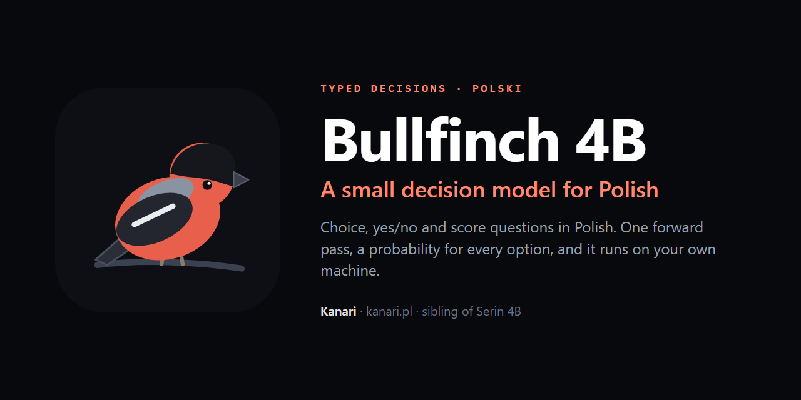

# Bullfinch 4B (gil)

A small decision model for Polish. It reads a state and one typed question (choice, yes/no or a
score) and returns a probability for every option from the option-letter logits of a single
forward pass; no text is generated. It is the general-purpose sibling of
[Serin 4B](https://huggingface.co/Takzen/serin-4b), the judge for chatbot security audits, and is
built the same way: QLoRA on Qwen3.5-4B, trained and served on a laptop GPU.

**Status: planning.** Data sources are listed below; no weights yet.

## Why

Small decision models (Jev and its open alternatives) are trained mostly on English. Their authors
say that in other languages they stay close to the base model. Serin showed that a 4B model tuned
on Polish decisions cuts false alarms of the base model from 131 to 5 out of 183 on its task.
Bullfinch tries the same for everyday Polish decisions, using human labels instead of synthetic
data, which is where Serin hit its ceiling.

## Data

Only sets with human or source labels and a licence that allows an open model. Official test
splits are never trained on, and neither is any training row that shares a text with a test row:
in PSC 3,023 of the 4,302 training pairs reuse a summary from the test split, so they are dropped.

| Set | Decision | Train / val / test | Licence |
|---|---|---|---|
| [allegro/klej-polemo2-in](https://huggingface.co/datasets/allegro/klej-polemo2-in) | review sentiment, 4 options | 5,783 / 723 / 722 | CC BY-SA 4.0 |
| [allegro/klej-polemo2-out](https://huggingface.co/datasets/allegro/klej-polemo2-out) | the same, other domains (test only) | – / 494 / 494 | CC BY-SA 4.0 |
| [allegro/klej-dyk](https://huggingface.co/datasets/allegro/klej-dyk) | does the answer answer the question, yes/no | 4,154 / – / 1,029 | CC BY-SA 3.0 |
| [allegro/klej-psc](https://huggingface.co/datasets/allegro/klej-psc) | do two summaries describe the same article, yes/no | 4,302 / – / 1,078 | CC BY-SA 3.0 |
| [ipipan/polqa](https://huggingface.co/datasets/ipipan/polqa) | is the passage evidence for the question, yes/no | 7,000 questions, 87,525 labelled passages | CC BY-SA 4.0 |
| [NASK-PIB/PLLuM-Align](https://huggingface.co/datasets/NASK-PIB/PLLuM-Align) | which of two answers is better; human ratings as scores | to count | CC BY-SA 4.0 |
| [AmazonScience/massive](https://huggingface.co/datasets/AmazonScience/massive) pl-PL | user intent, 60 options | 11,514 / 2,033 / 2,974 | CC BY 4.0 |
| [utahnlp/x-fact](https://huggingface.co/datasets/utahnlp/x-fact) pl | claim veracity, 7 levels | 1,325 / 176 / 267 | MIT |
| [mhardalov/exams](https://huggingface.co/datasets/mhardalov/exams) pl | school exam questions, multiple choice | 1,577 / 394 / – | CC BY-SA 4.0 |
| [Davlan/sib200](https://huggingface.co/datasets/Davlan/sib200) pol_Latn | topic, 7 options | 701 / 99 / 204 | CC BY-SA 4.0 |

Licence still to confirm before use: [allegro/klej-cbd](https://huggingface.co/datasets/allegro/klej-cbd)
(cyberbullying, yes/no, 10,041 / 1,000),
[allegro/klej-allegro-reviews](https://huggingface.co/datasets/allegro/klej-allegro-reviews)
(rating 1–5 as a score, 9,577 / 1,002 / 1,006) and
[allegro/klej-nkjp-ner](https://huggingface.co/datasets/allegro/klej-nkjp-ner) (entity type,
15,794 / 1,941 / 2,058).

**Evaluation only, never trained on:**
[facebook/belebele](https://huggingface.co/datasets/facebook/belebele) pol_Latn (900 reading
comprehension questions, CC BY-SA 4.0),
[CohereLabs/include-base-44](https://huggingface.co/datasets/CohereLabs/include-base-44) Polish
(548 regional-knowledge questions, Apache 2.0),
[jgeuter/OpenDecisions](https://huggingface.co/datasets/jgeuter/OpenDecisions) (2,352 Jev-style
decisions; its card asks not to train on it) and the official test split of every set above.

**Left out:** CDSC-E and CDSC-R, `sdadas/8tags` and `sdadas/ppc` (non-commercial licences), and
`decisionmodels/sn92-generalist-train-v1`, whose text and labels were written by commercial models.
Bullfinch is never trained on the outputs of commercial models or decision APIs.

## Plan

1. Converters: every set into the decision-example format Serin uses (template `decision-v1`),
   with several Polish phrasings of each question.
2. Baselines on the test splits: Qwen3.5-4B before training, Bielik, Serin 4B.
3. QLoRA pilot, then error analysis before adding data.
4. Results on every test split, Belebele, INCLUDE and the Polish items of OpenDecisions.
5. Publish as `Takzen/bullfinch-4b`; the licence of the weights is decided once the data list is
   final, with every source attributed.
